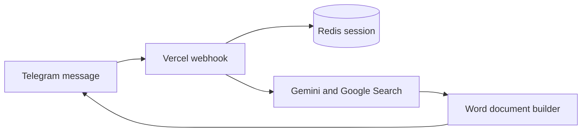

# Research Agent

A Telegram research assistant that turns a topic into a structured **Word report with source links**. It asks clarifying questions, researches with Gemini and Google Search grounding, and sends the resulting `.docx` file back to the conversation.

**TypeScript · Gemini · Upstash Redis · Telegram Bot API · Vercel**

## User flow

1. Send `/start`, then a research topic.
2. Answer the assistant's three to five clarifying questions in one message; `any` skips extra preferences.
3. Follow progress updates in Telegram.
4. Receive the generated Word document, including the sources returned by search grounding.

`/help` explains the flow; `/cancel` clears the saved conversation session. It does not guarantee that an already-running background research request is stopped.

## Architecture



The webhook acknowledges updates immediately and processes work through `waitUntil`. Redis holds the topic, clarification stage, and research state across serverless invocations. Update IDs are deduplicated for ten minutes; saved sessions expire after six hours.

## Run locally

Use a current Node.js runtime compatible with the TypeScript and Vercel dependencies, plus npm. You need a Telegram bot, Gemini API access, and an Upstash Redis database.

```bash
git clone https://github.com/sobhanashine/research-agent.git
cd research-agent
npm ci
cp .env.example .env.local
```

Fill in these server-side environment variables:

| Variable | Purpose |
| --- | --- |
| `TELEGRAM_BOT_TOKEN` | Bot access from BotFather |
| `GEMINI_API_KEY` | Clarification and grounded research |
| `UPSTASH_REDIS_REST_URL` | Redis REST endpoint |
| `UPSTASH_REDIS_REST_TOKEN` | Redis access token |

Keep `.env.local` out of Git. The provider accounts and their usage limits are managed separately; this repository does not guarantee a free production deployment.

### Choose a development mode

| Command | Mode |
| --- | --- |
| `npm run dev` | Vercel development server for the webhook route |
| `npm run local` | Telegram long polling with local environment loading |
| `npm run deploy` | Publish to Vercel production |

Use a separate development bot for polling: `npm run local` removes that bot's configured webhook before reading updates. For webhook development, expose the local Vercel server over HTTPS and point the development bot at `/api/telegram`.

## Deployment

1. Link the repository to the intended Vercel project and configure the four variables above in its production environment.
2. Deploy with `npm run deploy`.
3. Register the deployed HTTPS `/api/telegram` endpoint as the bot's Telegram webhook.
4. Use Telegram's `getWebhookInfo` to confirm the target and delivery errors, then exercise `/start` → topic → answers → document with the development bot before switching operational use.

[vercel.json](vercel.json) configures a 60-second function duration. Model latency, quota retries, and report generation still have to fit the platform's execution limits; the immediate webhook acknowledgement is not a completion guarantee.

## Repository map

| File | Responsibility |
| --- | --- |
| [api/telegram.ts](api/telegram.ts) | Webhook, conversation stages, and Telegram progress updates |
| [lib/research.ts](lib/research.ts) | Clarifying questions, grounded research, and source extraction |
| [lib/state.ts](lib/state.ts) | Redis sessions and update deduplication |
| [lib/docx.ts](lib/docx.ts) | Markdown-to-Word report generation |
| [lib/telegram.ts](lib/telegram.ts) | Telegram messaging and document delivery |
| [scripts/local.ts](scripts/local.ts) | Local long-polling runner |

## Troubleshooting

- **No bot response:** verify the environment in the active runtime and inspect Telegram's webhook delivery status. Polling and webhook delivery should not compete for the same bot.
- **Repeated or stalled work:** inspect the update ID and Redis session stage; `/cancel` clears the saved session.
- **Research failure:** check model availability, quota, execution time, and the server logs. A report's citations are the grounding links returned by Gemini and still need editorial review.

The package currently defines development and deployment scripts, without an automated test-suite command. The complete topic-to-document flow is the practical integration check.

---

By [Sobhan Ashineh](https://github.com/sobhanashine) · [Full portfolio at FMS](https://futuremservices.ir/en/work)
